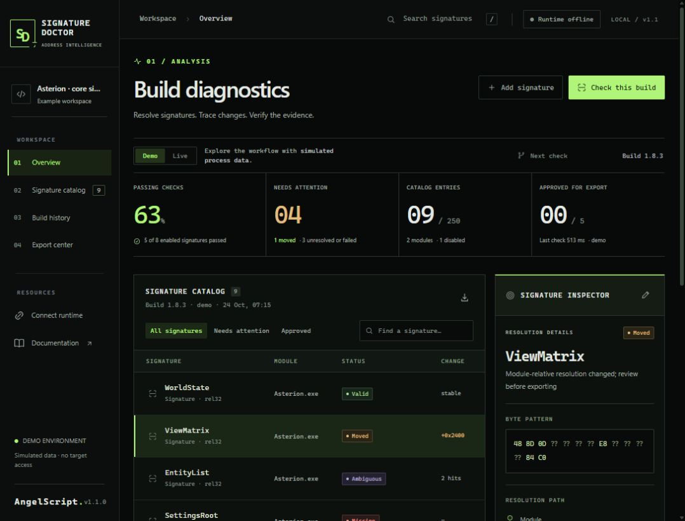
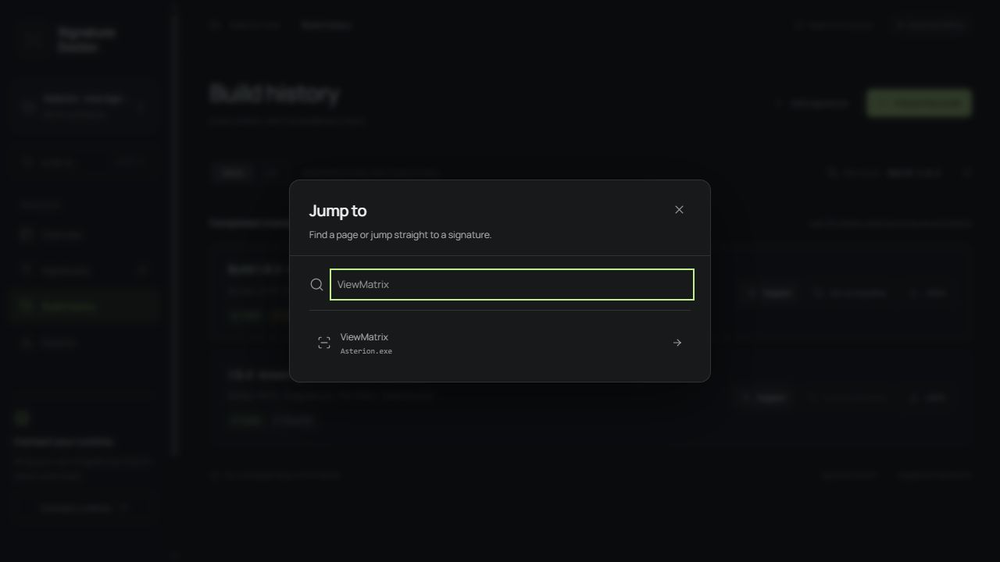
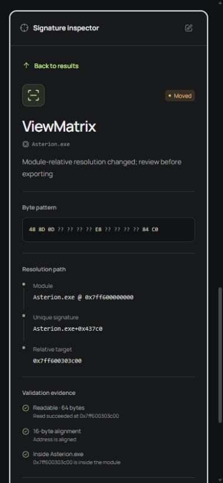
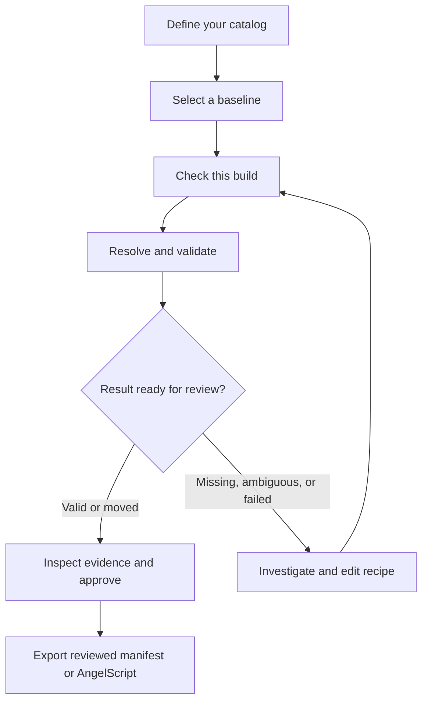
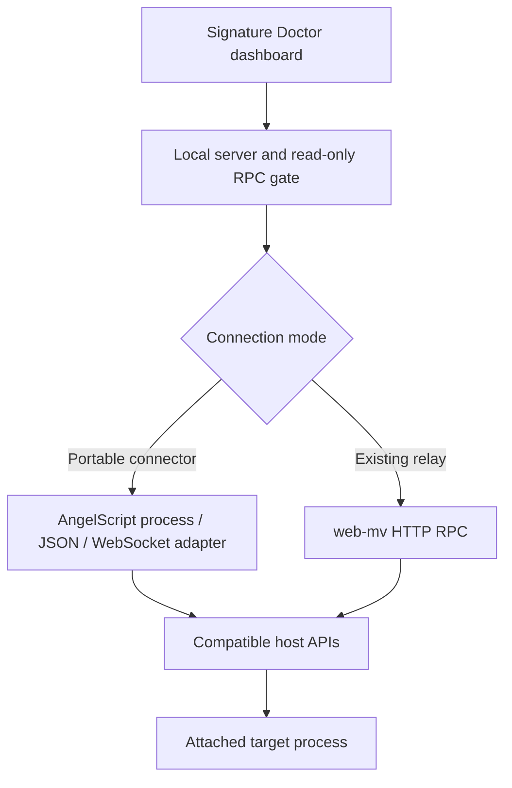

<p align="center">
  
</p>

<h1 align="center">SIGNATURE DOCTOR</h1>
<p align="center"><b>Resolve signatures. Trace changes. Verify the evidence.</b></p>

<p align="center">
  <a href="https://github.com/b4rzY/Signature-Doctor/actions/workflows/ci.yml"></a>
  
  
  
</p>

<p align="center">
  A signature and offset maintenance workbench for AngelScript runtimes.<br />
  Local diagnostics, build comparison, and reviewed exports.
</p>

<p align="center">
  <a href="#quick-start">Quick start</a> ·
  <a href="#connect-an-angelscript-host">Connect a runtime</a> ·
  <a href="#the-workflow">Workflow</a> ·
  <a href="docs/CATALOG.md">Catalog reference</a> ·
  <a href="docs/ARCHITECTURE.md">Architecture</a> ·
  <a href="docs/COMPATIBILITY.md">Host compatibility</a>
</p>

---

## Signature maintenance, in one workbench

Keep signatures, module offsets, and pointer chains in a named catalog. Check a build, compare it with a baseline, and inspect each result before approving an export. The inspector shows resolution steps and validation evidence alongside the catalog.

It is a **local application**. The dashboard and its Node server run on your machine. You can connect a compatible AngelScript host through the included portable adapter, reuse an existing [web-mv](https://github.com/Jozkah/web-mv) relay, or explore a clearly labeled synthetic demo without a target process.

<p align="center">
  
  <br /><sub>Current noir workbench · real browser capture · simulated demo data.</sub>
</p>

### The interface

Charcoal surfaces, locally hosted Manrope typography, restrained lime controls, and Lucide icons define the noir workspace. A build summary explains what needs attention; the interactive signature map opens each result in the inspector. Baseline and current addresses sit beside the resolution path and validation evidence. Recent checks link directly to their retained reports.

Use **Ctrl/Cmd + K** to search pages and signatures, **/** to search the catalog, and the arrow keys to move between signature names. The layout adapts to narrow screens with collapsible navigation. Scan completion and dialog transitions respect reduced-motion preferences. Status labels distinguish results without relying on color alone.

On narrow screens, selecting a signature takes you straight to its evidence; **Back to results** returns to the catalog. Mobile navigation keeps keyboard focus inside the drawer.

<details>
<summary>More interface screenshots</summary>





</details>

Visual tokens and component guidance live in [DESIGN.md](DESIGN.md).

### What you get

| Capability | What it does |
| --- | --- |
| **Named resolver catalog** | Store IDA-style signatures, module-relative addresses, signed addends, rel32 references, and bounded pointer chains. |
| **Evidence trail** | Inspect candidate addresses, each resolution step, readable-byte checks, numeric ranges, alignment, and module membership. |
| **Build comparison** | Compare against an explicitly chosen baseline while separating module relocation from changes to module offsets. |
| **Review before export** | Approve eligible results individually. Export a reviewed JSON manifest or runtime AngelScript resolvers. |
| **Local history** | Keep the latest 20 runs, baseline selection, and review choices in the browser. Download reports and catalog JSON. |
| **Two live connections** | Use the portable AngelScript connector or share an existing web-mv relay. |
| **Working demo** | Exercise the same resolution engine through a simulated RPC target, including missing and ambiguous signatures. |

## The workflow

Define your expected addresses, check a known build, and compare later runs against that baseline. Review the evidence before exporting.



1. **Define the catalog.** Your catalog holds the recipes: give each item a stable ID, readable name, module, resolution method, and meaningful checks.
2. **Establish the baseline.** Check a known build, inspect its results, and explicitly select it as your baseline.
3. **Check the updated build.** Signature Doctor resolves the current catalog against the connected target and records what it observed.
4. **Follow the evidence.** Open an item to inspect its resolution path, previous/current locations, and failed checks. A changed address is a reason to look closer.
5. **Approve and export.** Only explicitly reviewed `Valid` or `Moved` results can enter the export. Changing the catalog requires a fresh check.

### Read the result correctly

| Status | Meaning | Export eligible? |
| --- | --- | --- |
| **Valid** | The recipe resolved uniquely and its configured checks passed. | Yes, after review |
| **Moved** | A comparable module-relative location changed while the recipe and checks still passed. | Yes, after review |
| **Ambiguous** | More than one signature match exists. No candidate is silently chosen. | No |
| **Missing** | The expected module or signature could not be found. | No |
| **Validation failed** | A recipe or check failed, for example a null pointer or an implausible value. | No |
| **Read error** | A transport, protocol, or memory-read failure prevented a reliable result. | No |
| **Disabled** | The catalog item was intentionally excluded. | No |

**A match still needs validation.** `Valid` means “passed this recipe's checks.” A readable address by itself does not establish that it represents the intended object. Add byte, range, alignment, or module checks that describe what you expect.

## Quick start

**Requirements:** [Node.js 22 or newer](https://nodejs.org/), npm, and a modern browser. A compatible AngelScript host is needed only for live checks. See [host compatibility](docs/COMPATIBILITY.md) for the required bindings.

```bash
git clone https://github.com/b4rzY/Signature-Doctor.git
cd Signature-Doctor
npm ci
npm start
```

Open **[http://127.0.0.1:3210](http://127.0.0.1:3210)**.

The demo lets you inspect a complete workflow immediately. Its fictional `Asterion.exe` target has synthetic modules and memory. Demo JSON exports are marked as demo data; AngelScript export requires a live run.

Windows users can also use **`run.bat`**. On macOS/Linux, use **`bash run.sh`**. These launchers check the Node version and install dependencies when needed.

## Connect an AngelScript host

AngelScript is the language; process access, networking, and JSON support are supplied by the embedding application. Signature Doctor's portable connector targets a documented shared subset of those host APIs. It does not assume every AngelScript embedding has them.

### A. Portable connector

1. Start Signature Doctor with `npm start`.
2. Choose **Connect runtime → Download connector**, or open [`examples/angelscript-connect.as`](examples/angelscript-connect.as), and set `PROCESS_NAME` to your target executable.
3. Place the script in your host's script folder and load it through its script loader.
4. Confirm the connector reports that it is attached and connected.
5. In **Signature catalog**, choose **New catalog** to start with an empty catalog for your process, or **Import catalog** to load existing recipes.
6. Select **Live** and run **Check this build**.

The adapter implements Signature Doctor's read-only request protocol using `process::`, `ws::`, and `json::`. It connects to **`ws://127.0.0.1:3210/agent`**. There is no dependency on a host's built-in process-socket API.

```cpp
const string PROCESS_NAME = "YourApplication.exe";
const string RELAY_URL = "ws://127.0.0.1:3210/agent";
```

These are the configuration values in the complete adapter. Keep its request handling, bounds checks, and lifecycle callbacks intact. Use one direct connector per running Signature Doctor server.

### B. Reuse web-mv

If [web-mv](https://github.com/Jozkah/web-mv) already has a working connection to your runtime, keep that connection and route Signature Doctor through its HTTP RPC endpoint. Do not load the direct connector in this mode.

**PowerShell**

```powershell
$env:WEB_MV_URL = "http://127.0.0.1:9000/rpc"
npm start
```

**macOS / Linux**

```bash
WEB_MV_URL=http://127.0.0.1:9000/rpc npm start
```

The proxy accepts a configured loopback URL. The same bounded, read-only command allowlist applies. web-mv's extension agent is not required for the resolver operations used here; compatibility still depends on its own runtime adapter.

### Connection layout



### Host compatibility

| Target host | Connection | Basis of support | Live verification |
| --- | --- | --- | --- |
| **Echo** | Shared `angelscript-connect.as` adapter | Public Process, WebSocket, and JSON API documentation | Not run against a live installation |
| **Solanius** | The same shared adapter | Supplied full host API reference, including compatible process/read/scan, WebSocket, and JSON bindings | Not run against a live installation |
| **Other AngelScript hosts** | Implement or adapt the [connector protocol](docs/PROTOCOL.md) | Must provide the required host bindings or an equivalent bridge | Depends on the adapter |

The connector deliberately avoids `process::open_socket`, which is not documented in both host profiles. The portable one-argument `process::attach(name)` call works with both documented signatures. The [compatibility guide](docs/COMPATIBILITY.md) records differences, script locations, and the remaining runtime checks.

## Create your catalog

Choose **Signature catalog → New catalog** to create an empty project with its own name and expected process, or import a catalog JSON file. Creating or importing a catalog replaces the current browser workspace after confirmation; save the current catalog first if you want to keep it. Add entries in the dashboard. This small example describes a signature that points to a module-resident state object:

```json
{
  "schemaVersion": 1,
  "id": "my-tool",
  "name": "My tool signatures",
  "processName": "MyApp.exe",
  "items": [
    {
      "id": "main-state",
      "name": "MainState",
      "module": "MyApp.exe",
      "kind": "signature",
      "pattern": "48 8B 05 ?? ?? ?? ?? 48 85 C0",
      "relative": { "offset": 3, "instructionSize": 7 },
      "addend": "0x0",
      "checks": [
        { "type": "readable", "size": 8 },
        { "type": "alignment", "value": 8 },
        { "type": "in_module", "module": "MyApp.exe" }
      ]
    }
  ]
}
```

**This is an illustrative recipe.** Replace the module, pattern, and checks with values you established for your own target. A rel32 resolution returns the referenced address; it does not implicitly dereference a pointer stored at that address.

The [catalog reference](docs/CATALOG.md) covers all resolver kinds, pointer semantics, validation types, limits, and numeric representation.

## Review and export

Inspect each eligible result, approve the entries you have reviewed, and export their resolution recipes with the checks that support them.

### Reviewed JSON manifest

Contains only the approved entries, their resolution recipes, configured checks, definition fingerprints, and observed evidence from the selected run. The recorded absolute address is labeled as an observation. The recipe is what consumers should resolve against the current process.

### AngelScript resolvers

Generates a standalone `.as` script for a **live**, reviewed result set. The output:

- Resolves signatures again and requires exactly one match.
- Recomputes module-relative and rel32 references with checked address arithmetic.
- Walks pointers using success-reporting reads and rejects null pointers.
- Repeats every configured validation and the dashboard's implicit readability check.
- Publishes the resolved globals only after every selected entry succeeds.
- Uses the common documented `process::attach(PROCESS_NAME)` form.

No observed heap address is embedded as a persistent runtime constant. Generated identifiers are sanitized and disambiguated. An empty selection, failed result, changed catalog, or stale item definition prevents export.

**Runtime verification:** generated resolvers and the portable connector were compiled and exercised with the real AngelScript 2.38.0 compiler/VM using API-shaped stubs and synthetic memory. This covers source compatibility and fixture behavior. It does not verify a live host installation, native networking, or actual process access. Compile and verify exports in your installed host before integrating them into a larger script. See the [verification scope](docs/COMPATIBILITY.md#verification-scope).

## Comparison rules that matter

- **ASLR is not a moved offset.** Module base relocation is normalized before comparison.
- **Heap movement is not a stable offset change.** Pointer recipes retain their module-relative source, and dynamic final addresses are identified separately.
- **Changed definitions need a fresh check.** Comparisons distinguish recipe changes from changes observed using the same recipe.
- **Demo and live are separate.** They cannot serve as each other's baseline.
- **Target identity is checked again.** A target/module identity change during a run rejects that run instead of publishing mixed observations.
- **Build labels are user supplied.** This version does not hash the target executable; its definition fingerprints describe catalog recipes.
- **Checks are sampled observations.** The application does not stop the target, and related reads are not an atomic memory snapshot.

## Development

```bash
npm ci
npm run verify
npm run dev
```

`npm run verify` checks JavaScript syntax and runs the automated tests. `npm run dev` serves the same application for development; it listens on all interfaces for preview tooling. Use `npm start` for the normal loopback-only session.

**Verification scope:** automated tests cover resolver, transport, exports, and interface workflows, including command search and retained keyboard focus. The redesign was inspected in a Chromium browser at desktop and 390px mobile widths, including the recipe editor, history, command search, selection/return focus, and navigation drawer. Screenshots above come from the running app. This is not exhaustive cross-browser or physical-device testing. Live host installations were unavailable; host compatibility is based on documented APIs and the checks in the [compatibility guide](docs/COMPATIBILITY.md#verification-scope).

Optional compiler/VM fixtures require AngelScript SDK **2.38.0** and a GNU-compatible C++17 compiler:

```bash
npm run verify:angelscript -- --sdk /path/to/sdk
```

These use the real language compiler with synthetic host APIs. They are separate from `npm run verify`; neither the SDK nor the native compiler is needed to run the dashboard.

| Area | Location |
| --- | --- |
| Browser interface | `public/` |
| Catalog validation and resolver engine | `shared/catalog.mjs`, `shared/engine.mjs` |
| Simulated target | `shared/demo.mjs` |
| Reviewed exports | `shared/export.mjs` |
| HTTP / WebSocket transport | `server/` |
| Portable AngelScript connector | `examples/angelscript-connect.as` |
| Automated tests | `tests/` |

The frontend is buildless, using native browser modules. Manrope, Lucide SVG paths, and GSAP are checked in under `public/`; after upgrading these development dependencies, run `npm run assets:sync` to refresh the browser assets. GSAP retains its license notice in the vendored script; font and icon licenses are included alongside their assets. The server has one runtime dependency, `ws`. There is no database service or external font/CDN requirement for the dashboard.

### Configuration

| Variable | Default | Purpose |
| --- | --- | --- |
| `PORT` | `3210` | Dashboard and direct-agent server port |
| `WEB_MV_URL` | Unset | Use a loopback web-mv RPC endpoint instead of a direct agent |
| `RPC_TIMEOUT_MS` | `30000` | Per-request timeout |

When changing `PORT` in direct mode, update the WebSocket URL in the AngelScript connector too.

## Troubleshooting

| Symptom | Check |
| --- | --- |
| Agent is disconnected | Start the local server first, confirm the target is running, and attach/connect the AngelScript adapter. |
| Direct connection fails | Check the adapter URL, server port, and whether another direct adapter is already connected. If using web-mv proxy mode, keep its adapter and do not load a second one. |
| Runtime disconnected after a restart | Use **Connect** in the loaded adapter. Disconnects require an explicit reconnect. |
| Every item is missing | Verify the catalog's module names against the connected target and ensure the correct executable is attached. |
| A signature is ambiguous | Tighten the pattern or revise the recipe. The application deliberately does not guess which match is correct. |
| Reads time out | Check the runtime/relay status. Large scans may exceed the configured timeout. Keep catalogs and signatures focused. |
| Export is disabled | Select a completed current run, review eligible entries, and use Live mode for AngelScript export. |
| Imported JSON is rejected | Check `schemaVersion`, unique IDs, string-form addresses/offsets, and the [catalog limits](docs/CATALOG.md#limits). |

## References and integration credits

- [AngelScript language and embedding documentation](https://www.angelcode.com/angelscript/sdk/docs/manual/index.html)
- [Host compatibility and API sources](docs/COMPATIBILITY.md)
- [Connector protocol](docs/PROTOCOL.md)
- [Jozkah / web-mv](https://github.com/Jozkah/web-mv), the companion memory-analysis workbench and optional existing relay

Signature Doctor adds catalog maintenance, comparison, and reviewed exports around process-inspection APIs. It does not provide live debugging, breakpoints, target-memory writes, or automatic offset repair.
