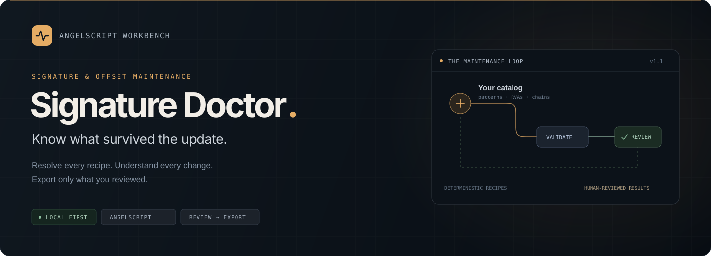
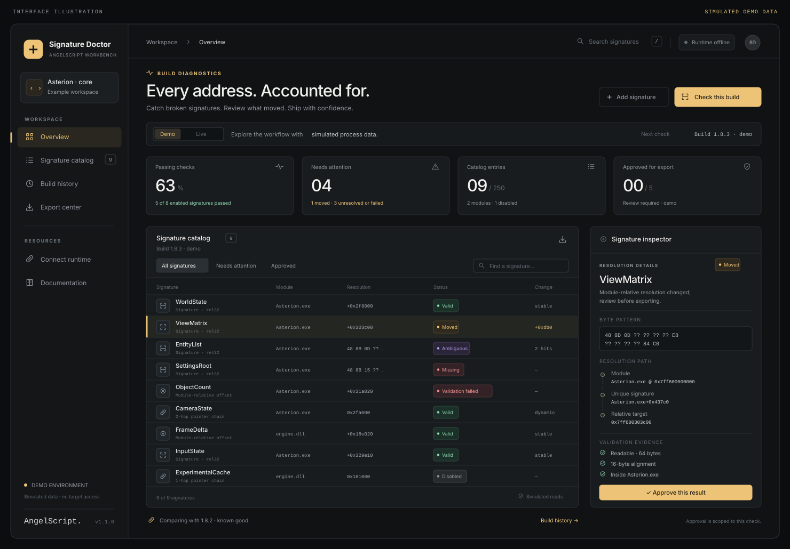
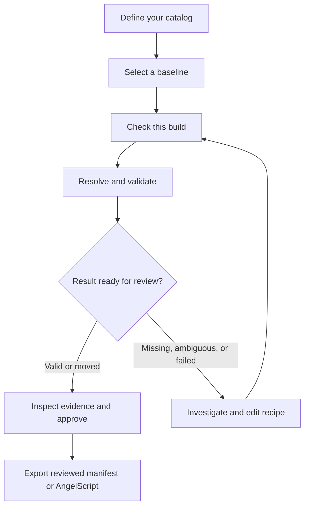
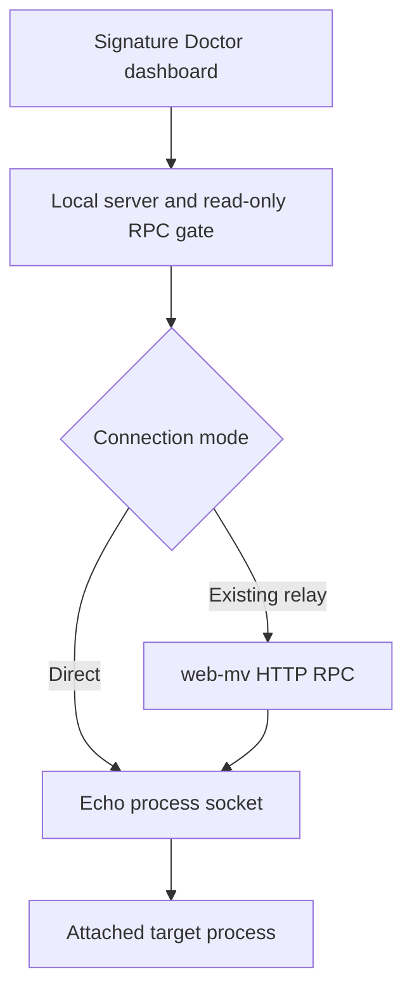

<p align="center">
  
</p>

<p align="center">
  <a href="https://github.com/b4rzY/Signature-Doctor/actions/workflows/ci.yml"></a>
  
  
  
</p>

<p align="center">
  <b>A signature and offset maintenance workbench for Echo.</b><br />
  Keep a named catalog. Check a new build. Inspect the evidence. Export only what you reviewed.
</p>

<p align="center">
  <a href="#quick-start">Quick start</a> ·
  <a href="#connect-to-echo">Connect Echo</a> ·
  <a href="#the-workflow">Workflow</a> ·
  <a href="docs/CATALOG.md">Catalog reference</a> ·
  <a href="docs/ARCHITECTURE.md">Architecture</a>
</p>

---

## The update happened. What still works?

Signature Doctor turns a collection of signatures, offsets, and pointer chains into a reviewable build report. Every result carries its resolution steps, validation outcomes, and comparison against the baseline you selected.

It is a **local application**. The dashboard and its Node server run on your machine. You can connect Echo directly, reuse an existing [web-mv](https://github.com/Jozkah/web-mv) relay, or explore a clearly labeled synthetic demo without a target process.

<p align="center">
  
  <br /><sub>Interface illustration · simulated demo data. This is a static illustration of the implemented interface, not a browser screenshot.</sub>
</p>

### What you get

| Capability | What it does |
| --- | --- |
| **Named resolver catalog** | Store IDA-style signatures, module-relative addresses, signed addends, rel32 references, and bounded pointer chains. |
| **Evidence, not just a color** | Inspect candidate addresses, each resolution step, readable-byte checks, numeric ranges, alignment, and module membership. |
| **Build comparison** | Compare against an explicitly chosen baseline while separating module relocation from changes to module offsets. |
| **Review before export** | Approve eligible results individually. Export a reviewed JSON manifest or runtime AngelScript resolvers. |
| **Local history** | Keep the latest 20 runs, baseline selection, and review choices in the browser. Download reports and catalog JSON. |
| **Two live connections** | Use the included Echo connector or share web-mv's existing core-agent connection. |
| **Working demo** | Exercise the same resolution engine through a simulated RPC target, including missing and ambiguous signatures. |

## The workflow



1. **Define the recipe.** Give each item a stable ID, readable name, module, resolution method, and meaningful checks.
2. **Check a known build.** Inspect the results and explicitly select it as your baseline.
3. **Check the updated build.** Signature Doctor resolves the current catalog against the connected target and records what it observed.
4. **Review the differences.** Open an item to inspect its resolution path, previous/current locations, and failed checks.
5. **Approve and export.** Only explicitly reviewed `Valid` or `Moved` results can enter the export. Changing the catalog requires a fresh check.

### Read the result correctly

| Status | Meaning | Export eligible? |
| --- | --- | --- |
| **Valid** | The recipe resolved uniquely and its configured checks passed. | Yes, after review |
| **Moved** | A comparable module-relative location changed while the recipe and checks still passed. | Yes, after review |
| **Ambiguous** | More than one signature match exists. No candidate is silently chosen. | No |
| **Missing** | The expected module or signature could not be found. | No |
| **Validation failed** | A recipe or check failed, for example a null pointer or an implausible value. | No |
| **Read error** | A transport, protocol, or memory-read failure prevented a reliable result. | No |
| **Disabled** | The catalog item was intentionally excluded. | No |

**Valid means “passed this recipe's checks.”** A readable address by itself does not establish that it represents the intended object. Add byte, range, alignment, or module checks that describe what you expect.

## Quick start

**Requirements:** [Node.js 22 or newer](https://nodejs.org/), npm, and a modern browser. Echo is needed only for live checks.

```bash
git clone https://github.com/b4rzY/Signature-Doctor.git
cd Signature-Doctor
npm ci
npm start
```

Open **[http://127.0.0.1:3210](http://127.0.0.1:3210)**.

The demo lets you inspect a complete workflow immediately. Its fictional `Asterion.exe` target has synthetic modules and memory. Demo JSON exports are marked as demo data; AngelScript export requires a live run.

Windows users can also use **`run.bat`**. On macOS/Linux, use **`bash run.sh`**. These launchers check the Node version and install dependencies when needed.

## Connect to Echo

Choose **one** connection approach. Echo's built-in process socket allows one active connection at a time.

### A. Direct Echo connection

1. Start Signature Doctor with `npm start`.
2. Open [`examples/echo-connect.as`](examples/echo-connect.as) and set `PROCESS_NAME` to your target executable.
3. Place the script in Echo's script folder and load it through your Echo loader.
4. Use the connector's attach/connect action if needed.
5. Switch the dashboard to **Live**, use a catalog for your target, and run **Check this build**.

The connector uses the current documented API:

```cpp
attach_data target = process::attach(PROCESS_NAME);
process::open_socket("ws://127.0.0.1:3210/agent");
```

These lines are explanatory; the complete connector includes the required `bool main()` and failure handling. The script uses the documented one-argument `process::attach` form. If your installed Echo build differs, adjust the connector to that build's API.

### B. Reuse web-mv

If [web-mv](https://github.com/Jozkah/web-mv) already has the Echo core socket, keep it connected and route Signature Doctor through its HTTP RPC endpoint. Do not load a second core connector.

**PowerShell**

```powershell
$env:WEB_MV_URL = "http://127.0.0.1:9000/rpc"
npm start
```

**macOS / Linux**

```bash
WEB_MV_URL=http://127.0.0.1:9000/rpc npm start
```

The proxy accepts a configured loopback URL. This application forwards only its bounded, read-only command allowlist. web-mv's extension agent is not required for the documented resolver workflow.

### Connection layout



## Create your catalog

Create entries in the dashboard or import a catalog JSON file. This small example describes a signature that points to a module-resident state object:

```json
{
  "schemaVersion": 1,
  "id": "my-tool",
  "name": "My tool signatures",
  "processName": "MyApp.exe",
  "items": [
    {
      "id": "main-state",
      "name": "MainState",
      "module": "MyApp.exe",
      "kind": "signature",
      "pattern": "48 8B 05 ?? ?? ?? ?? 48 85 C0",
      "relative": { "offset": 3, "instructionSize": 7 },
      "addend": "0x0",
      "checks": [
        { "type": "readable", "size": 8 },
        { "type": "alignment", "value": 8 },
        { "type": "in_module", "module": "MyApp.exe" }
      ]
    }
  ]
}
```

**This is an illustrative recipe.** Replace the module, pattern, and checks with values you established for your own target. A rel32 resolution returns the referenced address; it does not implicitly dereference a pointer stored at that address.

The [catalog reference](docs/CATALOG.md) covers all resolver kinds, pointer semantics, validation types, limits, and numeric representation.

## Review and export

### Reviewed JSON manifest

Contains only the approved entries, their resolution recipes, configured checks, definition fingerprints, and observed evidence from the selected run. The recorded absolute address is labeled as an observation. The recipe is what consumers should resolve against the current process.

### AngelScript resolvers

Generates a standalone `.as` script for a **live**, reviewed result set. The output:

- Resolves signatures again and requires exactly one match.
- Recomputes module-relative and rel32 references with checked address arithmetic.
- Walks pointers using success-reporting reads and rejects null pointers.
- Repeats every configured validation and the dashboard's implicit readability check.
- Publishes the resolved globals only after every selected entry succeeds.
- Uses the current documented `process::attach(PROCESS_NAME)` API.

No observed heap address is embedded as a persistent runtime constant. Generated identifiers are sanitized and disambiguated. An empty selection, failed result, changed catalog, or stale item definition prevents export.

**Runtime verification:** the JavaScript generator and its output contracts are covered by tests. An Echo host/AngelScript compiler is not included in this repository; compile and verify generated scripts against your installed runtime before integrating them into a larger script.

## Comparison rules that matter

- **ASLR is not a moved offset.** Module base relocation is normalized before comparison.
- **Heap movement is not a stable offset change.** Pointer recipes retain their module-relative source, and dynamic final addresses are identified separately.
- **Changed definitions need a fresh check.** Comparisons distinguish recipe changes from changes observed using the same recipe.
- **Demo and live are separate.** They cannot serve as each other's baseline.
- **Target identity is checked again.** A target/module identity change during a run rejects that run instead of publishing mixed observations.
- **Build labels are user supplied.** This version does not hash the target executable; its definition fingerprints describe catalog recipes.
- **Checks are sampled observations.** The application does not stop the target, and related reads are not an atomic memory snapshot.

## Development

```bash
npm ci
npm run verify
npm run dev
```

`npm run verify` checks JavaScript syntax and runs the automated tests. `npm run dev` serves the same application for development; it listens on all interfaces for preview tooling. Use `npm start` for the normal loopback-only session.

**Verification scope:** the resolver, transport, export, and interface logic have automated tests. Browser visual QA could not be performed in the build environment because its managed preview service was unavailable. The illustration above is labeled accordingly. A live Echo host and its AngelScript compiler were also unavailable.

| Area | Location |
| --- | --- |
| Browser interface | `public/` |
| Catalog validation and resolver engine | `shared/catalog.mjs`, `shared/engine.mjs` |
| Simulated target | `shared/demo.mjs` |
| Reviewed exports | `shared/export.mjs` |
| HTTP / WebSocket transport | `server/` |
| Echo connector | `examples/echo-connect.as` |
| Automated tests | `tests/` |

The frontend is buildless, using native browser modules. The server has one runtime dependency, `ws`. There is no database service or external font/CDN requirement for the dashboard.

### Configuration

| Variable | Default | Purpose |
| --- | --- | --- |
| `PORT` | `3210` | Dashboard and direct-agent server port |
| `WEB_MV_URL` | Unset | Use a loopback web-mv RPC endpoint instead of a direct agent |
| `RPC_TIMEOUT_MS` | `30000` | Per-request timeout |

When changing `PORT` in direct mode, update the WebSocket URL in the Echo connector too.

## Troubleshooting

| Symptom | Check |
| --- | --- |
| Agent is disconnected | Start the local server first, confirm the target is running, and attach/connect the Echo script. |
| `open_socket` fails | Echo may already be connected to web-mv or another tool. Use the existing-relay mode or close the other core socket. |
| Every item is missing | Verify the catalog's module names against the connected target and ensure the correct executable is attached. |
| A signature is ambiguous | Tighten the pattern or revise the recipe. The application deliberately does not guess which match is correct. |
| Reads time out | Check Echo/relay status. Large scans may exceed the configured timeout. Keep catalogs and signatures focused. |
| Export is disabled | Select a completed current run, review eligible entries, and use Live mode for AngelScript export. |
| Imported JSON is rejected | Check `schemaVersion`, unique IDs, string-form addresses/offsets, and the [catalog limits](docs/CATALOG.md#limits). |

## Acknowledgments and API references

Built for **Ech0** and the [Echo / Angel Universal API](https://echo-23.gitbook.io/angel).

- [Process API and socket routes](https://echo-23.gitbook.io/angel/memory/process)
- [Getting started and script entrypoint](https://echo-23.gitbook.io/angel)
- [Jozkah / web-mv](https://github.com/Jozkah/web-mv), the companion memory-analysis workbench and optional existing relay

Signature Doctor adds catalog maintenance, comparison, and reviewed exports around those documented capabilities. It does not provide live debugging, breakpoints, target-memory writes, or automatic offset repair.
